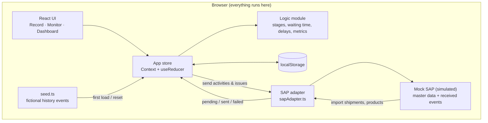
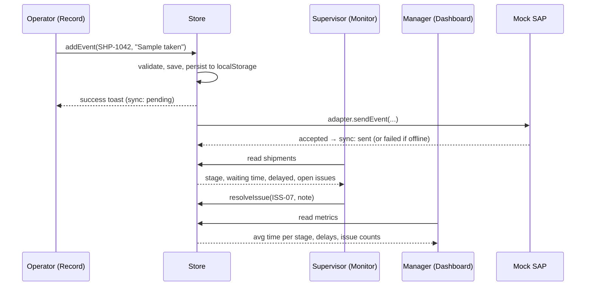

# TrackIt: Architecture and Technology Stack

TrackIt's purpose is to **integrate warehouse operations with SAP**. In the prototype, that integration is **simulated**: a mock SAP module inside the app plays the role of SAP. TrackIt is a **front-end-only** web prototype. Everything runs in the browser using fictional data. There is **no backend, no database server, no external API and no AI service**, as the brief requires.

---

## 1. Technology stack

| Layer | Choice | Why |
|-------|--------|-----|
| Language | **TypeScript** | Catches mistakes early. AI coding tools handle it well. |
| UI framework | **React** | Component-based, which fits the design system and Storybook |
| Build tool / dev server | **Vite** | Fast, one-command start (`npm run dev`) |
| Styling | **Plain CSS + CSS variables** (`tokens.css`) | The design tokens from `design.md` map 1:1. No extra framework to learn. |
| Routing | **React Router** (`HashRouter`) | Back button works. Runs on GitHub Pages without server config. |
| State | **React Context + `useReducer`** | One central store for shipments, events and issues |
| Persistence | **`localStorage`** + "Reset demo data" | Data survives a page refresh. No server needed. |
| SAP integration (prototype) | **Mock SAP module** (`src/integration/`) | Behaves like SAP (master data, accepts events, can be "offline") without any real connection |
| Charts | **Recharts** | Simple bar charts. Runs locally (it's a library, not an API). |
| Icons | **lucide-react** | Consistent, accessible icons |
| Font | **@fontsource/inter** | Font is bundled, with no call to an external font service |
| Component catalogue | **Storybook** | Required component storybook (see `design.md` §5) |
| Tests (light) | **Vitest** | Unit tests for the logic: waiting time, delays, metrics |
| Hosting (optional) | GitHub Pages | Lets the lecturer open a link without installing anything |

**Prerequisites:** Node.js 22 LTS (or 20.19+), npm, Git, and a modern browser.

**Agentic coding tool:** [Cursor / GitHub Copilot / Claude Code: fill in what we used]. Our prompts are kept in `PROMPTS.md`.

---

## 2. System overview



No arrows leave the browser. That is how we meet the **no APIs, no real data** rule.

**Why an adapter?** The rest of the app only talks to `sapAdapter.ts`. In a real deployment, the mock SAP is swapped for a real connection behind the same adapter, and the screens don't change. This shows how the integration is designed.

### Data flow for the main journey


---

## 3. Data model

```ts
type Stage = 'Received' | 'Awaiting sampling' | 'Sample taken' | 'Stored' | 'Picked' | 'Dispatched';
type Role = 'operator' | 'supervisor' | 'manager';
type Area = 'Inbound' | 'Storage' | 'Outbound';   // derived from stage

interface Shipment {
  id: string;            // "SHP-1042" (fictional)
  product: string;       // "Product A – vials, 2–8 °C" (fictional)
}

interface ActivityEvent {
  id: string;
  shipmentId: string;
  stage: Stage;
  recordedAt: string;    // ISO timestamp
  recordedBy: Role;      // role only, no personal names
  syncStatus: SyncStatus;
}

type SyncStatus = 'pending' | 'sent' | 'failed';

// Mock SAP (simulated)
interface SapMasterData {
  shipments: { sapDeliveryNo: string; shipmentId: string; product: string; expectedAt: string }[];
}
interface SapAdapter {
  importMasterData(): Promise<SapMasterData>;
  sendEvent(e: ActivityEvent | Issue): Promise<'sent' | 'failed'>;
  setOffline(offline: boolean): void;   // demo control
}

interface Issue {
  id: string;
  shipmentId: string;
  category: 'Damaged packaging' | 'Missing/unreadable label' | 'Temperature concern'
          | 'Documentation mismatch' | 'Other';
  description: string;
  status: 'open' | 'resolved';
  reportedAt: string;
  resolvedAt?: string;
  followUpNote?: string;
  syncStatus: SyncStatus;
}
```

**Derived values (not stored, calculated in `logic/`):**
- `currentStage` = stage of the latest event
- `area`: Received / Awaiting sampling / Sample taken → Inbound · Stored → Storage · Picked / Dispatched → Outbound
- `waitingMinutes` = now − latest event time
- `isDelayed` = waitingMinutes > 240 and stage ≠ Dispatched
- `hasOpenIssue`, dashboard metrics, area fill, arrivals and dispatches by hour, 7-day trend per day, rule-based insight sentences

**Seed data:** timestamps are generated **relative to the moment the data is loaded** (e.g. "now − 6 h"), so delayed and on-time examples are always visible during a demo. The seed covers **7 days** of history so the trend chart has data.

**Area capacity (fictional constants):** Inbound 12, Outbound 10.

---

## 4. Project structure

```
ESCP-2627DT-B<n>/
├── README.md
├── evidence.md
├── product.md
├── design.md
├── architecture.md
├── PROMPTS.md                 # prompts used with the coding agent
├── package.json
├── vite.config.ts
├── .storybook/                # Storybook config
├── public/
└── src/
    ├── main.tsx
    ├── App.tsx                # layout, router, header, nav
    ├── styles/
    │   ├── tokens.css         # design tokens from design.md
    │   └── global.css
    ├── data/
    │   ├── types.ts
    │   └── seed.ts            # fictional data only
    ├── store/
    │   └── AppStore.tsx       # context, reducer, localStorage
    ├── integration/
    │   ├── sapAdapter.ts      # interface the app uses
    │   ├── mockSap.ts         # simulated SAP: master data, outbox, offline switch
    │   └── sapMasterData.ts   # fictional SAP deliveries & products
    ├── logic/
    │   ├── shipments.ts       # stage, waiting time, delayed, area
    │   ├── metrics.ts         # dashboard numbers + insights
    │   └── *.test.ts          # Vitest tests
    ├── components/            # one folder per component
    │   └── Button/
    │       ├── Button.tsx
    │       ├── Button.css
    │       └── Button.stories.tsx
    └── screens/
        ├── RecordScreen.tsx
        ├── MonitorScreen.tsx
        ├── ShipmentDetailScreen.tsx
        ├── DashboardScreen.tsx
        └── SapIntegrationScreen.tsx
```

Routes: `#/record` · `#/monitor` · `#/monitor/:shipmentId` · `#/dashboard` · `#/sap`

---

## 5. Commands

| Command | What it does |
|---------|-------------|
| `npm install` | Install dependencies (once after cloning) |
| `npm run dev` | Start the app at `http://localhost:5173` |
| `npm run storybook` | Open the component Storybook at `http://localhost:6006` |
| `npm test` | Run logic tests |
| `npm run build` | Production build into `dist/` |

---

## 6. Security, privacy and compliance boundaries
- **Fictional data only.** No real shipments, products, companies or people. Roles are labels, not accounts.
- **No secrets.** No API keys, `.env` files or passwords in the repo. `node_modules/` and `dist/` are in `.gitignore`.
- **No network calls.** The app must work with Wi-Fi turned off after `npm install`.
- **The SAP connection is simulated** and labelled as such on screen. No SAP credentials, URLs or real system names are in the code.
- **Role switcher ≠ security.** It only changes the view. A real product would need authentication, server-side role-based access, audit trails and validation.
- TrackIt records **operational observations**. It never creates or changes official batch, inventory, serial-number or quality records, and never approves release.

## 7. Future production architecture (not built)
A real deployment would add: company single sign-on with MFA, a backend API with server-side permissions, a database with a tamper-evident audit trail, a **real two-way SAP integration** behind the same `sapAdapter` (for example through SAP OData services or IDocs, via the company's integration platform), with idempotent sending, retries, reconciliation and interface monitoring; WMS integration through approved interfaces; data-retention and GDPR controls, and a risk-based validation assessment (EU GMP Annex 11, GAMP 5) together with Quality Assurance and IT. An AI issue-classification feature could be evaluated later, if users ask for it.
